# Tamil Information Retrieval System Using Inverted and Positional Indexing

A comprehensive, Unicode-aware Information Retrieval (IR) system designed for Tamil-language news articles. This project implements index construction, regular inverted indexing, positional inverted indexing, and multi-mode query processing (Single-Term, Boolean AND, Boolean OR, and Exact Phrase search) from first principles in Python.

---

## 1. Problem Statement

Information Retrieval in Indic languages such as Tamil presents unique linguistic and computational challenges:
1. **Unicode Orthography & Combining Marks:** Tamil uses base consonants, independent vowels, the *aytham* letter (`ஃ`), combining vowel signs (*matras*, e.g., `ா`, `ி`, `ீ`, `ு`, `ூ`, `ெ`, `ே`, `ை`, `ொ`, `ோ`, `ௌ`), and the *pulli/virama* (`்`). Standard ASCII tokenizers (`[a-zA-Z]+` or naive `\w+`) detach combining signs from base consonants or mangle Unicode character points.
2. **Decomposition vs. Composition:** Unicode text can exist in Decomposed form (NFD) or Composed form (NFC). Without strict canonical normalization, visually identical Tamil words produce mismatched binary representations.
3. **Word Proximity and Order:** While Boolean search (bag-of-words) retrieves documents containing required terms anywhere in the text, it cannot verify syntactic phrases. For instance, *"தமிழக அரசு"* (Government of Tamil Nadu) and the inverted *"அரசு தமிழக"* carry fundamentally different contextual meanings. Standard inverted indexes cannot distinguish between them without positional offsets.
4. **Multilingual Infiltration:** Real-world Tamil news articles frequently embed English acronyms (e.g., *AI*, *DMK*, *ISRO*), loan words, dates, and numbers. The retrieval system must normalize English case while preserving Tamil Unicode integrity.

This project addresses these challenges by providing an end-to-end, academic-grade IR pipeline engineered specifically for Tamil news text.

---

## 2. Project Objectives

- **Unicode Preprocessing Pipeline:** Perform canonical Unicode NFC normalization, whitespace normalization, punctuation separation, and Unicode-aware tokenization preserving Tamil combining marks and embedded alphanumeric tokens.
- **Positional Inverted Index:** Construct a single-pass positional index mapping terms to document IDs and sorted zero-based token offsets:
  $$\text{Positional Index: } \{\text{term} \rightarrow \{\text{doc\_id}: [p_0, p_1, \dots]\}\}$$
- **Regular Inverted Index:** Efficiently derive postings lists of sorted document IDs directly from the positional index without redundant corpus rescanning:
  $$\text{Regular Index: } \{\text{term} \rightarrow [\text{doc\_id}_0, \text{doc\_id}_1, \dots]\}$$
- **Multi-Mode Retrieval Engine:**
  1. *Single-Term Search:* Direct $O(1)$ inverted index lookup.
  2. *Boolean AND Search:* Linear-time postings-list intersection ($O(|A| + |B|)$) with Document Frequency ($df$) optimization.
  3. *Boolean OR Search:* Linear-time postings-list union merge ($O(|A| + |B|)$).
  4. *Exact Phrase Search:* Positional index verification enforcing consecutive token offsets ($p + k$).
- **Academic Storage and Performance Evaluation:** Persist all indexes into UTF-8 JSON structures, measure search response times in milliseconds, extract relevant snippets, and evaluate system correctness through automated unit and integration tests.

---

## 3. Dataset Description & Statistics

- **Dataset Name:** Hindu Tamil News Articles Dataset
- **Source:** [Hugging Face — Shwetasss/HinduTamil-News-Articles-Dataset](https://huggingface.co/datasets/Shwetasss/HinduTamil-News-Articles-Dataset)
- **Local File:** `data/0000.parquet` (20.6 MB)
- **Language:** Tamil (`ta`) with embedded English terminology and numbers.
- **Dataset Schema:**
  - `Title` (string): Headline of the news article.
  - `Author` (string): Journalist or news division (e.g., *செய்திப்பிரிவு*).
  - `City` (string): City of reporting (e.g., *சென்னை*, *மதுரை*, *கோவை*).
  - `Published` (string): Publication timestamp.
  - `Text` (string): Full body text of the article.

### Actual Corpus Statistics (Measured)

| Metric | Measured Value | Notes |
|---|---|---|
| **Total Original Records** | **10,334** | Verified directly from Parquet file |
| **Missing / Null Values** | **0** | All 5 fields are 100% complete across all rows |
| **Empty Strings** | **0** | No blank articles or missing titles |
| **Duplicate Articles (Title + Text)** | **0** | 10,334 distinct document contents |
| **Total Indexed Documents** | **10,334** | Assigned deterministic IDs $0 \dots 10333$ |
| **Vocabulary Size ($V$)** | **168,277** | Unique normalized terms |
| **Total Indexed Tokens ($T$)** | **2,659,417** | Combined Title and Text tokens |
| **Average Tokens per Document** | **257.35** | Standard news article length |
| **Texts Differing from NFC** | **1,318** | Required canonical NFC normalization |
| **Texts with Non-Breaking Spaces** | **294** | Handled during whitespace normalization |

---

## 4. System Architecture

```mermaid
flowchart TD
    A["Parquet Dataset<br/><code>data/0000.parquet</code>"] --> B["Document Loader<br/><code>load_dataset()</code>"]
    B --> C["Metadata & Document Store<br/><code>documents.json</code>"]
    B --> D["Combined Text Stream<br/><code>Title + ' ' + Text</code>"]
    D --> E["Unicode NFC & Case Normalizer<br/><code>normalize_text()</code>"]
    E --> F["Unicode Regex Tokenizer<br/><code>[\p{L}\p{N}][\p{L}\p{M}\p{N}]*</code>"]
    F --> G["Positional Inverted Indexer<br/><code>term -> {doc_id: [positions]}</code>"]
    G --> H["Academic Postings Derivation<br/><code>term -> [sorted doc_ids]</code>"]
    G --> I["Vocabulary Dictionary<br/><code>df</code> & <code>cf</code> Calculation"]
    G --> J["Persistent Storage (JSON)<br/><code>indexes/</code>"]
    H --> J
    I --> J
    
    K["User Search Query<br/>(Term / AND / OR / Phrase)"] --> L["Query Preprocessor<br/><code>preprocess.tokenize()</code>"]
    L --> M{"Search Router"}
    
    M -->|"Single Term"| N["Regular Inverted Index<br/>Direct Postings Lookup"]
    M -->|"Boolean AND"| O["Postings Intersection<br/>Sorted by df ascending"]
    M -->|"Boolean OR"| P["Postings Union Merge<br/>Deduplicated Sorted Join"]
    M -->|"Exact Phrase"| Q["Positional Index Verification<br/>Offset Consecutive Check"]
    
    N --> R["Contextual Snippet Generator<br/><code>_generate_snippet()</code>"]
    O --> R
    P --> R
    Q --> R
    
    R --> S["Academic Result Display & CLI<br/>Doc ID, Title, Positions, Time (ms)"]
```



---

## 5. Tamil Text Preprocessing (`preprocess.py`)

Tamil text processing requires strict adherence to Indic Unicode mechanics:

### 1. Unicode NFC Normalization
Decomposed sequences (where a consonant and vowel sign are stored as two distinct code points) are canonically composed into single NFC code points using Python's `unicodedata.normalize('NFC', text)`. In our dataset, 1,318 articles contained decomposed sequences that would have failed matching without this step.

### 2. Unicode Category-Aware Tokenizer
Standard regular expressions such as `\w+` or `[a-zA-Z]+` fail on Tamil text by either dropping combining marks or splitting compound syllables. We use the Unicode-aware regex engine with character category properties:
```python
TOKEN_PATTERN = re.compile(r"[\p{L}\p{N}][\p{L}\p{M}\p{N}]*", re.UNICODE)
```
- `\p{L}`: Matches any Unicode Letter (Tamil consonants, independent vowels, *aytham*, Grantha letters `ஜ`, `ஷ`, `ஸ`, `ஹ`, `க்ஷ`, and English letters).
- `\p{N}`: Matches any Unicode Number (ASCII digits `0-9` and Tamil numerals).
- `\p{M}`: Matches any Unicode Combining Mark (Tamil vowel signs/matras `ா, ி, ீ, ு, ூ, ெ, ே, ை, ொ, ோ, ௌ` and *pulli/virama* `்`).
- Requirement: Tokens must begin with a base letter or number, followed by zero or more letters, marks, or digits. This ensures that combining marks are never severed from their base consonant.

### 3. Lowercasing & Stop Words
- Embedded English words are lowercased (`.lower()`) to ensure case-insensitive matching. Tamil letters do not have case distinctions and remain unaffected.
- Tamil stop words are **intentionally preserved**. Stop word removal degrades exact phrase searching (e.g., removing particles like *"மற்றும்"*, *"ஆகும்"*, or *"உள்ள"* prevents reconstructing contiguous phrase token sequences).
- English Porter stemming is **not applied** to Tamil words, as English morphological rules do not apply to agglutinative Dravidian languages.

---

## 6. Index Construction (`build_index.py`)

### Positional Inverted Index
For every document $d \in D$, the Title and Text are concatenated with a space delimiter (`f"{Title} {Text}"`). As tokens are extracted sequentially, their zero-based positions ($0, 1, 2, \dots$) are recorded.
```json
{
  "தமிழ்நாடு": {
    "2": [0, 9, 29, 80, 98, 115],
    "6": [61],
    "10": [151]
  },
  "சென்னை": {
    "0": [2],
    "1": [0, 2, 6],
    "4": [12]
  }
}
```

### Regular Inverted Index & Academic Postings Derivation
A classic regular inverted index stores only document IDs:
```json
{
  "தமிழ்நாடு": [2, 6, 10, 12, 13, 16, 18, 20, 28, 57],
  "சென்னை": [0, 1, 4, 7, 8, 11, 14, 15, 20, 22]
}
```
**Academic Note:** A positional inverted index is a strict superset of a regular inverted index. Because `positional_index[term]` already holds all matching document IDs as keys, the regular inverted index is derived directly:
```python
inverted_index[term] = sorted([int(doc_id) for doc_id in positional_index[term].keys()])
```
This eliminates the need to rescan the 10,334 documents, completing index generation in **$O(1)$** per document posting.

### Why Both Indexes Are Retained
1. **Academic Demonstration:** Illustrates the architectural evolution from standard Boolean retrieval to positional proximity searching.
2. **Query Execution Efficiency:** Single-term and Boolean AND/OR queries do not require word offsets. Reading compact postings lists (`[12, 45]`) reduces memory bandwidth and avoids iterating over positional arrays.
3. **Space-Time Tradeoff:** Demonstrates the trade-off between index size and retrieval capability.

---

## 7. Index Storage Specification (`indexes/`)

All generated indexes are persisted in the `indexes/` directory using UTF-8 encoding with `ensure_ascii=False` so Tamil text remains human-readable:

| File Name | Size on Disk | Purpose |
|---|---|---|
| `inverted_index.json` | **16.52 MB** | Maps each term to a sorted array of integer document IDs. |
| `positional_index.json` | **35.05 MB** | Maps each term to `{doc_id: [positions]}` for phrase search. |
| `dictionary.json` | **9.23 MB** | Vocabulary store containing document frequency (`df`) and collection frequency (`cf`). |
| `documents.json` | **63.34 MB** | Document store mapping `doc_id` to `Title`, `Author`, `City`, `Published`, and original `Text`. |
| `metadata.json` | **1.15 KB** | Provenance metadata, configuration, timestamps, and actual dataset statistics. |

*Note on GitHub Limits:* All index files are below GitHub's 100 MB hard file limit.

---

## 8. Retrieval Algorithms (`search.py`)

### A. Single-Term Search
- Query term is normalized and tokenized.
- Retrieves postings from `inverted_index.json` in $O(1)$ dictionary lookup time.
- Returns matching document count, document IDs, titles, snippets, and execution time.

### B. Boolean AND Search (Postings Intersection)
Given query terms $T = \{t_1, t_2, \dots, t_k\}$:
1. Lookup postings lists $L_1, L_2, \dots, L_k$.
2. Sort postings lists in ascending order of length ($df$). The smallest postings list is intersected first to minimize intermediate candidate sets.
3. Apply standard two-pointer intersection in $O(|L_a| + |L_b|)$:
   ```python
   while i < len_a and j < len_b:
       if list_a[i] == list_b[j]:
           result.append(list_a[i])
           i += 1; j += 1
       elif list_a[i] < list_b[j]:
           i += 1
       else:
           j += 1
   ```

### C. Boolean OR Search (Postings Union)
Given query terms $T = \{t_1, t_2, \dots, t_k\}$:
1. Merge postings lists using a two-pointer sorted union merge in $O(|L_a| + |L_b|)$.
2. Eliminates duplicates while preserving ascending document ID order.

### D. Exact Phrase Search (Positional Verification)
Given phrase tokens $w_0, w_1, \dots, w_{k-1}$:
1. **Candidate Pruning:** Identify documents containing *all* distinct terms via intersection of document ID keys from `positional_index`.
2. **Positional Alignment:** For each candidate document $d$, let $P_i = \text{positional\_index}[w_i][d]$. Find all start positions $p \in P_0$ such that:
   $$\forall m \in [1, k-1]: (p + m) \in P_m$$
3. By representing $P_m$ as a hash set, membership check is $O(1)$, making verification $O(|P_0| \cdot k)$.
4. Records the exact matching start positions and extracts snippets centered directly on the phrase.

---

## 9. Installation & Execution Guide (Windows PowerShell)

### Prerequisites
- Python 3.10+ (tested on Python 3.14 on Windows 11)
- Windows PowerShell

### Step 1: Activate Virtual Environment
```powershell
.\.venv\Scripts\Activate.ps1
```

### Step 2: Install Dependencies
```powershell
pip install -r requirements.txt
```

### Step 3: Build the Indexes
Builds regular and positional indexes from `data/0000.parquet` and saves them to `indexes/`:
```powershell
python -X utf8 build_index.py
```
*(Execution time: approximately 5.4 seconds for 10,334 documents)*

### Step 4: Run Interactive Search Engine
Launch the full interactive command-line interface:
```powershell
python -X utf8 main.py
```

### Step 5: Run Standalone CLI Searches
You can execute searches directly from the command line:

- **Single-Term Search:**
  ```powershell
  python -X utf8 search.py --mode term --query "சென்னை" --limit 5
  ```

- **Boolean AND Search:**
  ```powershell
  python -X utf8 search.py --mode and --query "சென்னை AND மழை" --limit 5
  ```

- **Boolean OR Search:**
  ```powershell
  python -X utf8 search.py --mode or --query "தமிழ்நாடு OR சென்னை" --limit 5
  ```

- **Exact Phrase Search:**
  ```powershell
  python -X utf8 search.py --mode phrase --query "தமிழக அரசு" --limit 5
  ```

- **View Corpus & Index Statistics:**
  ```powershell
  python -X utf8 main.py --stats
  ```

- **Inspect Vocabulary Entry for a Tamil Term:**
  ```powershell
  python -X utf8 main.py --inspect-term "தமிழ்நாடு"
  ```

---

## 10. Actual Sample Search Outputs

### 1. Single-Term Search: "சென்னை"
```
============================================================
TAMIL INFORMATION RETRIEVAL SYSTEM
============================================================
Query: சென்னை
Search Type: Single-Term Search
Matching Documents: 6530
------------------------------------------------------------
Result #1
Document ID: 0
Title: தமிழகத்தில் விபத்தில்லாமல் பணிபுரிந்த அரசுப் பேருந்து ஓட்டுநர்களுக்கு தங்க, வெள்ளி நாணயங்கள் வழங்கல்
Snippet: தமிழகத்தில் விபத்தில்லாமல் பணிபுரிந்த அரசுப் பேருந்து ஓட்டுநர்களுக்கு தங்க, வெள்ளி நாணயங்கள் வழங்கல். சென்னை: மாநகர் போக்குவரத்துக் கழகம் மற்றும் அரசு விரைவுப் போக்குவரத்து கழகங்களில், கடந்த 25 ஆண்டுகளுக்கு மேல் ...
Metadata: City=சென்னை | Published=2024-02-26 17:48:00
------------------------------------------------------------
Search Time: 0.07 ms
============================================================
```

### 2. Boolean AND Search: "சென்னை AND மழை"
```
============================================================
TAMIL INFORMATION RETRIEVAL SYSTEM
============================================================
Query: சென்னை AND மழை
Search Type: Boolean AND Search
Matching Documents: 728
------------------------------------------------------------
Result #1
Document ID: 20
Title: மக்களவைத் தேர்தலில் பாஜக உடன் தமாகா கூட்டணி: ஜி.கே.வாசன் அறிவிப்பு
Snippet: மக்களவைத் தேர்தலில் பாஜக உடன் தமாகா கூட்டணி: ஜி.கே.வாசன் அறிவிப்பு. சென்னை: "பாஜக தலைமையில் மக்களவை தேர்தலை சந்திக்கிறது தமிழ் மாநில காங்கிரஸ்" என்று அக்கட்சியின் தலைவர் ஜி.கே.வாசன் ...
Metadata: City=சென்னை | Published=2024-02-26 10:40:00
------------------------------------------------------------
Search Time: 0.52 ms
============================================================
```

### 3. Boolean OR Search: "தமிழ்நாடு OR சென்னை"
```
============================================================
TAMIL INFORMATION RETRIEVAL SYSTEM
============================================================
Query: தமிழ்நாடு OR சென்னை
Search Type: Boolean OR Search
Matching Documents: 6863
------------------------------------------------------------
Result #1
Document ID: 0
Title: தமிழகத்தில் விபத்தில்லாமல் பணிபுரிந்த அரசுப் பேருந்து ஓட்டுநர்களுக்கு தங்க, வெள்ளி நாணயங்கள் வழங்கல்
Snippet: தமிழகத்தில் விபத்தில்லாமல் பணிபுரிந்த அரசுப் பேருந்து ஓட்டுநர்களுக்கு தங்க, வெள்ளி நாணயங்கள் வழங்கல். சென்னை: மாநகர் போக்குவரத்துக் கழகம் மற்றும் அரசு விரைவுப் போக்குவரத்து கழகங்களில் ...
Metadata: City=சென்னை | Published=2024-02-26 17:48:00
------------------------------------------------------------
Search Time: 0.58 ms
============================================================
```

### 4. Exact Phrase Search: "தமிழக அரசு" (Strict Positional Matching)
```
============================================================
TAMIL INFORMATION RETRIEVAL SYSTEM
============================================================
Query: தமிழக அரசு
Search Type: Exact Phrase Search
Matching Documents: 1798
------------------------------------------------------------
Result #1
Document ID: 0
Title: தமிழகத்தில் விபத்தில்லாமல் பணிபுரிந்த அரசுப் பேருந்து ஓட்டுநர்களுக்கு தங்க, வெள்ளி நாணயங்கள் வழங்கல்
Matched Positions: [53]
Snippet: ... பரிசு மற்றும் பாராட்டு சான்றிதழ்களையும் தமிழக போக்குவரத்துத் துறை அமைச்சர் சிவசங்கர் வழங்கினார்.
இதுதொடர்பாக தமிழக அரசு வெளியிட்டுள்ள செய்திக் குறிப்பு: மறைந்த முதல்வர் கருணாநிதி நூற்றாண்டு விழாவினை முன்னிட்டு ...
Metadata: City=சென்னை | Published=2024-02-26 17:48:00
------------------------------------------------------------
Result #2
Document ID: 4
Title: பரந்தூர் விமான நிலைய எதிர்ப்பு போராட்டம்: 150+ விவசாயிகள் கைது - போலீஸ் நடவடிக்கையால் பரபரப்பு
Matched Positions: [46]
Snippet: ... பரந்தூர் புதிய விமான நிலையத்துக்கான நில எடுப்புக்கான முதல்நிலை அறிவிப்பை தமிழக அரசு வெளியிட்டுள்ளது. காஞ்சிபுரம் வட்டத்தில் உள்ள பொடவூர் கிராமத்தில் நிலம் எடுப்பதற்கான அறிவிப்பு ...
Metadata: City=காஞ்சிபுரம் | Published=2024-02-26 16:30:00
------------------------------------------------------------
Search Time: 4.59 ms
============================================================
```

### Word-Order Sensitivity Proof:
- `"தமிழக அரசு"` (Government of Tamil Nadu) matches **1,798 documents**.
- Reversed `"அரசு தமிழக"` matches only **19 documents** (where syntax coincided with phrases like *"... மத்திய அரசு தமிழக அரசுடன் ..."*).
- Simple Boolean AND (`தமிழக AND அரசு`) matches **2,922 documents**.
- This proves:
  $$\text{Matches}(\text{"தமிழக அரசு"}) \subset \text{Matches}(\text{தமிழக AND அரசு})$$
  Exact phrase searching strictly enforces adjacent word order using positional postings.

---

## 11. Automated Test Suite (`tests/`)

The project includes 35 comprehensive unit and integration tests using Python's built-in `unittest` framework:

```powershell
python -X utf8 -m unittest discover -s tests -p "test_*.py" -v
```

### Test Coverage Summary:
- `tests/test_preprocessing.py` (9 tests):
  - Unicode NFC normalization
  - Tamil vowel signs (*matras*) not split
  - Tamil *pulli/virama* preservation
  - Grantha consonants (`ஜ, ஷ, ஸ, ஹ, க்ஷ`) and *aytham* (`ஃ`)
  - Embedded English lowercasing and number preservation
  - Whitespace and non-breaking space cleaning
  - Empty string edge cases
  - Token boundary character spans
- `tests/test_indexing.py` (4 tests):
  - Positional inverted index structure and repeated word positions
  - Regular inverted index derivation
  - Vocabulary dictionary ($df$ and $cf$) calculation
  - Index JSON serialization, UTF-8 integrity, and deserialization
- `tests/test_search.py` (16 tests):
  - Single-term search (found vs absent)
  - Boolean AND search (2 terms, 3 terms, empty intersection)
  - Boolean OR search (2 terms, 3 terms)
  - Exact phrase search (2 terms, multi-word)
  - Reversed phrase order verification
  - Repeated term phrase search (e.g., *"நாடு நாடு"*)
  - Absent term in phrase search
  - Empty, punctuation, and quote-encapsulated queries
  - English case-insensitive query matching
  - Index reload consistency (identical results before and after reloading)
- `tests/test_integration.py` (6 tests):
  - Corpus scale validation (10,334 documents, 168,277 vocabulary)
  - Live term search on *"சென்னை"*
  - Live Boolean AND on *"சென்னை AND மழை"*
  - Live Boolean OR on *"தமிழ்நாடு OR சென்னை"*
  - Live exact phrase search on *"தமிழக அரசு"*
  - Verification that phrase matches are a strict subset of Boolean AND matches

**Test Execution Result:** `Ran 35 tests in 1.348s — OK (100% Pass Rate)`

---

## 12. Project Folder Structure

```
IR-Assignment/
├── .gitignore                     # Git ignore file (excludes raw parquet & temp files)
├── requirements.txt               # Project dependencies (pandas, pyarrow, regex)
├── README.md                      # Comprehensive project documentation
├── preprocess.py                  # Unicode-aware Tamil preprocessing & tokenizer
├── build_index.py                 # Index construction & JSON serialization module
├── search.py                      # Multi-mode search engine & snippet generator
├── main.py                        # Interactive CLI application & entry point
├── generate_outputs.py            # Real output generator script
├── data/
│   └── 0000.parquet               # Hindu Tamil News Articles Dataset (10,334 records)
├── indexes/
│   ├── inverted_index.json        # Regular inverted index (16.52 MB)
│   ├── positional_index.json      # Positional inverted index (35.05 MB)
│   ├── dictionary.json            # Vocabulary df and cf dictionary (9.23 MB)
│   ├── documents.json             # Document metadata & text store (63.34 MB)
│   └── metadata.json              # Provenance & build statistics (1.15 KB)
├── outputs/
│   ├── index_statistics.txt       # Real index & collection statistics output
│   ├── term_search.txt            # Real single-term search examples
│   ├── boolean_and_search.txt     # Real Boolean AND search examples
│   ├── boolean_or_search.txt      # Real Boolean OR search examples
│   ├── phrase_search.txt          # Real exact phrase search examples
│   └── index_example.txt          # Detailed term postings & positions sample
└── tests/
    ├── __init__.py                # Tests package marker
    ├── test_preprocessing.py      # Unicode & tokenization unit tests
    ├── test_indexing.py           # Index building & serialization unit tests
    ├── test_search.py             # Single-term, Boolean, & phrase search unit tests
    └── test_integration.py       # Integration tests on live dataset
```

---

## 13. System Limitations & Future Extensions

1. **Morphological Stemming / Lemmatization:** Tamil is an agglutinative language with rich case suffixes (e.g., *சென்னை* [Chennai], *சென்னையில்* [in Chennai], *சென்னைக்கு* [to Chennai], *சென்னையை* [accusative]). Currently, exact token matching treats inflected forms as distinct vocabulary entries. A rule-based Tamil morphological analyzer or stemmer could improve recall.
2. **Relevance Ranking:** The current implementation returns matches in deterministic Document ID order as specified by the assignment requirements. A natural extension is computing TF-IDF or BM25 scores with cosine similarity to rank documents by relevance.
3. **Spelling Correction & Fuzzy Matching:** N-gram indexing or Levenshtein distance matching could handle phonetic Tamil typing variations and orthographic typos.

---

## 14. Dataset Attribution & Copyright Notice

- **Dataset Title:** Hindu Tamil News Articles Dataset
- **Publisher / Curator:** Shweta S. (`Shwetasss`) on Hugging Face
- **Source URL:** [https://huggingface.co/datasets/Shwetasss/HinduTamil-News-Articles-Dataset](https://huggingface.co/datasets/Shwetasss/HinduTamil-News-Articles-Dataset)
- **Content:** The underlying news articles originate from *Hindu Tamil Thisai* news publications.
- **Copyright & Redistribution Notice:** The raw news articles are copyrighted by their respective publishers and are provided for educational and academic research purposes under fair use. In accordance with repository policies, the raw Parquet file is excluded from public git tracking (`.gitignore`), while instructions and data loaders enable reproduction by downloading the dataset directly from the source repository.
